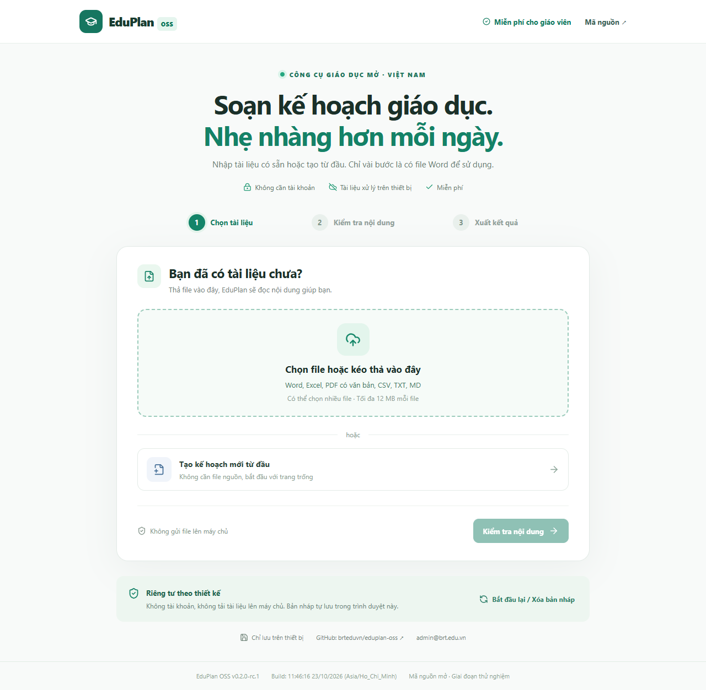
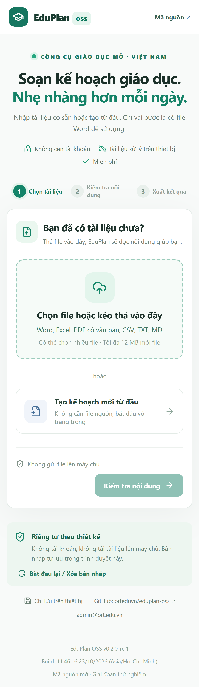

# EduPlan OSS 🇻🇳

**A free, privacy-first, open-source education planning web app. Vietnam first, international-ready architecture later.**

📷 Xem giao diện trên máy tính và điện thoại / Screenshots

### 🔗 Đường dẫn ngắn, dễ nhớ

- **Ứng dụng web (GitHub Pages):** https://brteduvn.github.io/ — sau khi bật GitHub Pages cho repository.
- **Mã nguồn:** https://github.com/brteduvn/brteduvn.github.io
- **Liên hệ:** admin@brt.edu.vn

## Tiếng Việt

**EduPlan OSS** giúp giáo viên tạo kế hoạch giáo dục theo quy trình trực quan:

**Chọn tài liệu → Kiểm tra và chỉnh sửa → Tải Word / In thành PDF**

Không cần đăng ký tài khoản, không yêu cầu API AI trả phí, không gửi tài liệu của người dùng lên máy chủ.

### Chức năng hiện có — v0.2.0-rc.2

| Chức năng | Trạng thái | Giới hạn |
|---|---|---|
| Tạo mới không cần file | Có | Nội dung điền và chỉnh sửa thủ công |
| Nhập nhiều Word DOCX | Có | Trích văn bản; bảng định dạng phức tạp có thể chưa giữ nguyên |
| Nhập Excel XLSX | Có | Đọc dữ liệu cơ bản từ trang tính |
| Nhập PDF có lớp văn bản | Có | PDF scan/ảnh **chưa** hỗ trợ OCR |
| CSV, TXT, Markdown | Có | CSV có dấu phân cách và văn bản trong ngoặc kép |
| Chỉnh sửa trường và nội dung | Có | Gợi ý trường chỉ mang tính tham khảo |
| Tự lưu và tiếp tục bản nháp | Có | Lưu trong trình duyệt hiện tại, không đồng bộ thiết bị khác |
| Xuất Word A4 | Có | Mẫu đơn giản, Times New Roman 13pt; nên kiểm tra bố cục |
| Sử dụng mẫu DOCX riêng | Có | Mẫu cần đánh dấu thẻ; một số cấu trúc OOXML phức tạp chưa hỗ trợ |
| In hoặc lưu PDF | Có | Sử dụng chức năng in/lưu PDF của trình duyệt |
| Web App cài lên màn hình chính | Có | PWA; trình duyệt và thiết bị cần hỗ trợ |
| Dùng offline sau lần mở thành công | Cơ bản | Cache bộ ứng dụng; không bảo đảm mọi đường dẫn/tệp ngoài được cache |
| AI miễn phí và kiểm tra PPCT theo quy định | Chưa | Phát triển và kiểm chứng trong các phiên bản sau |

**Cam kết về sự đơn giản:** Không bắt xem hướng dẫn; thao tác chính được trình bày trực tiếp, gợi ý ngắn theo ngữ cảnh.

### Tải Word theo mẫu trường

Chọn **Word theo mẫu của tôi** ở bước xuất. Mở Word và gõ các thẻ sau vào vị trí cần điền:

- \`{{school}}\` · \`{{subject}}\` · \`{{grade}}\` · \`{{teacher}}\`
- \`{{title}}\` · \`{{content}}\`

Có thể tải mẫu DOCX tham khảo ngay trong Web App. Trình điền mẫu có thể nhận dạng các thẻ bị Word chia giữa nhiều text run nhưng vẫn có trường hợp biểu mẫu đặc biệt phải kiểm tra thủ công.

### Quyền riêng tư

Dữ liệu nguồn được xử lý **trong trình duyệt**, bản nháp được tự lưu bằng bộ nhớ cục bộ của trình duyệt. Dùng máy công cộng? Hãy nhấn **Bắt đầu lại / Xóa bản nháp** sau khi xuất xong. Nếu xóa dữ liệu trình duyệt hoặc đổi thiết bị, bản nháp có thể mất. Không tải tài liệu học sinh thật lên Issues/PRs. Xem [PRIVACY.md](PRIVACY.md).

## English

EduPlan OSS is a browser-based, local-first document planning toolkit for educators. The public beta supports multi-format text extraction (DOCX/XLSX/text-based PDF/CSV/TXT/MD), editing, a browser-saved draft, editable A4 Word export and custom placeholder-based DOCX templates, plus browser printing to PDF.

**Limitations:** This is *not* a certified Vietnam curriculum validator. Arbitrary Word layout inference, OCR of scanned PDFs, local free AI, and international curriculum packs are not yet implemented. New features are not advertised as shipped until verified.

### Build and test

Requirements: Node.js **22+** and npm.

\`\`\`bash
git clone https://github.com/brteduvn/brteduvn.github.io.git
cd brteduvn.github.io
npm ci
npm run dev
\`\`\`

Quality gates before publishing:

\`\`\`bash
npm run typecheck
npm test
npm audit --audit-level=moderate
npm run build
npm run test:e2e
\`\`\`

The version, UTC timestamp and Vietnam build time are embedded into \`dist/build-info.json\` and the interface footer. Every release uses an incremented SemVer version, a Git commit/tag and a checksum manifest. [Release workflow](.github/workflows/release.yml) packages the Web App, and [Pages workflow](.github/workflows/pages.yml) deploys the live site. To enable the live link, see [DEPLOYMENT.md](docs/DEPLOYMENT.md).

### Development and community

- Frontend: React 19, TypeScript, Vite, responsive CSS, installable PWA.
- Processing: JSZip and DOCX, read-excel-file, pdfjs-dist (loaded when needed).
- Tests: Vitest and manual browser QA. Planned: device matrix and visual Word regression tests.
- [Roadmap](ROADMAP.md) · [Architecture](docs/ARCHITECTURE.md) · [Contributing](CONTRIBUTING.md)
- [Security](SECURITY.md) · [Privacy](PRIVACY.md) · [Code of Conduct](CODE_OF_CONDUCT.md)
- [Release policy and backups](docs/PROJECT_POLICY.md) · [Changelog](CHANGELOG.md)
- [License MIT](LICENSE)

Maintainer: **[@brteduvn](https://github.com/brteduvn)** · **admin@brt.edu.vn**.

Only this project is published to GitHub. Other connected/local projects remain local with separate Git/version/backup policy. No fabricated adoption, GitHub stars or PR history will be used in OpenAI program applications.
